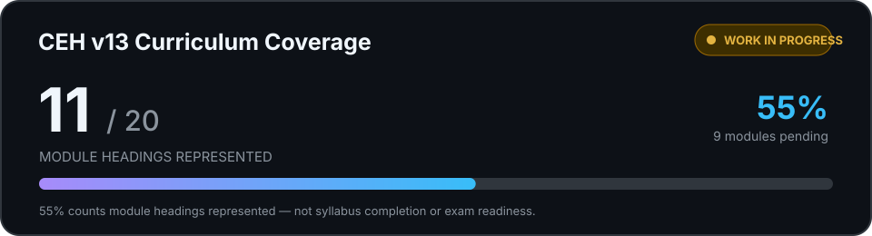

# CEH v13 Study Reference

<p align="center">
  
</p>

> **Work in progress.** The tracker currently represents the curriculum from **Introduction to Ethical Hacking through Session Hijacking**.
>
> - **Current coverage:** Modules 01–11, with 54 topic labels.
> - **Pending:** Modules 12–20. All nine module titles are listed below.
> - **Important:** The 54 topic entries are partial study prompts, not exhaustive coverage of the first 11 modules.
>
> **The 55% indicator counts official module headings represented. It does not measure syllabus completion, learning progress, or exam readiness.**

An independent, browser-based study tracker for organizing revision against the EC-Council Certified Ethical Hacker (CEH) v13 course outline.

This is a personal study companion. It is not an official EC-Council product, is not endorsed by EC-Council, and does not replace official courseware, labs, or the current exam blueprint.

## Curriculum coverage

The official CEH v13 course outline lists 20 modules. This tracker currently contains topic entries for the first 11 module headings only.

### Currently represented

1. Introduction to Ethical Hacking
2. Footprinting and Reconnaissance
3. Scanning Networks
4. Enumeration
5. Vulnerability Analysis
6. System Hacking
7. Malware Threats
8. Sniffing
9. Social Engineering
10. Denial-of-Service
11. Session Hijacking

The 54 entries are concise study labels, not full module objectives, lesson notes, or proof that every topic in these modules is covered.

### Planned — not yet included

12. Evading IDS, Firewalls, and Honeypots
13. Hacking Web Servers
14. Hacking Web Applications
15. SQL Injection
16. Hacking Wireless Networks
17. Hacking Mobile Platforms
18. IoT and OT Hacking
19. Cloud Computing
20. Cryptography

**Coverage indicator:** 11 of 20 official module headings are represented (55%). This is a count of module headings present in the tracker—not a measure of exam readiness, learning completion, or full syllabus coverage.

**Curriculum source:** [EC-Council — Certified Ethical Hacker (CEH) v13 course outline](https://www.eccouncil.org/train-certify/certified-ethical-hacker-ceh/). The official course outline and licensed course materials remain authoritative. Verify them for changes before relying on this tracker for exam preparation.

_Last checked against the published outline: 7 November 2026._

## Features

- 11 represented modules and 54 current topic labels.
- Module-level and overall progress tracking.
- Topic search and module navigation.
- Expand/collapse controls.
- Local progress persistence using browser `localStorage`.
- Progress export and import as JSON.
- Responsive layout and reduced-motion handling.
- No account, application backend, analytics, or remote progress synchronization.

## Run locally

The module list is loaded from `assets/data/Modules-Conf.json`. Serve the repository over HTTP rather than opening `index.html` with the `file://` protocol.

```bash
python3 -m http.server 8000
```

Open [http://127.0.0.1:8000](http://127.0.0.1:8000).

## Deploy with Firebase Hosting

The root-level `firebase.json` publishes the repository root.

```bash
firebase login
firebase deploy --only hosting --project YOUR_FIREBASE_PROJECT_ID
```

Replace `YOUR_FIREBASE_PROJECT_ID` with the ID of the Firebase project you intend to deploy to. The Firebase CLI must be installed and authenticated.

## Repository layout

```text
.
├── assets/
│   ├── data/Modules-Conf.json
│   ├── favicon/
│   └── fonts/
├── index.html
├── script.js
├── style.css
├── 404.html
├── firebase.json
├── .gitignore
├── CONTRIBUTING.md
└── README.md
```

## Progress data and privacy

Progress is stored in the current browser profile. It is not synchronized to a server or shared between devices by this application. Use the export function to create a backup; imported files are treated as untrusted input and are validated against the topics currently present in the tracker.

The application does not require an account or application backend. The locally bundled fonts and favicon are loaded from this repository.

## Accuracy and content scope

This project is currently a **progress tracker**, not a complete CEH study reference or a set of study notes. It does not currently provide full explanations, demonstrations, lab walkthroughs, or exhaustive topic coverage. Its current 11-module scope must not be interpreted as complete coverage of those modules.

The 20-module outline is used only as a curriculum organizer. Topic labels are study prompts and should be checked against EC-Council's current official outline and course materials. Module titles, objectives, exam domains, and course content may change.

## Contributing

Content changes should use concise, original topic descriptions. Do not reproduce textbook passages, slides, lab manuals, exam questions, answer keys, licensed course assets, or leaked exam content. Identify the public syllabus or source used for any coverage claim.

Before expanding the dataset, preserve stable progress mapping or provide a migration so existing study records are not silently assigned to different topics.

## License and permissions

This repository is **proprietary; all rights reserved**. You may view it where access is granted. For a public repository, GitHub's Terms of Service permit users to view and fork it on GitHub. Those platform permissions do not grant a general right to reuse, modify, redistribute, sublicense, or commercially exploit the original material outside GitHub.

Obtain prior, express, written permission from the copyright holder before any such use beyond the rights GitHub grants. Sending a request is not approval; wait for written authorization. See [LICENSE](./LICENSE) for the full scope, exclusions, permission-request route, and treatment of earlier license grants.

**Third-party material:** This notice covers only original material that the repository owner owns or is authorized to license. Third-party software, images, fonts, trademarks, curricula, standards, datasets, contributions, and other external content remain subject to their respective rights and terms. This repository does not relicense them.

**Course-material boundary:** EC-Council syllabi, course materials, exam questions, lab manuals, official branding, and other supplied assets remain the property of their respective rights holders. This repository is an independent study reference and does not grant rights to those materials.

